<div align="center">

# Seu Navegador

**A lightweight, RAM-efficient, 100% themeable Windows browser built in Rust + CEF, with an integrated Studio IDE & Multi-Agent Orchestrator.**

[](./LICENSE-MIT)
[](#building--running)
[](#architecture)

[**🇧🇷 Ler em Português (PT-BR)**](./README.pt-BR.md) · [**Theme Authoring Guide**](./docs/theme-guide.md) · [**RAM Benchmark**](./bench/README.md) · [**QA Test Plan**](./docs/test-plan.md) · [**Spec**](./docs/SPEC.md)

<br />

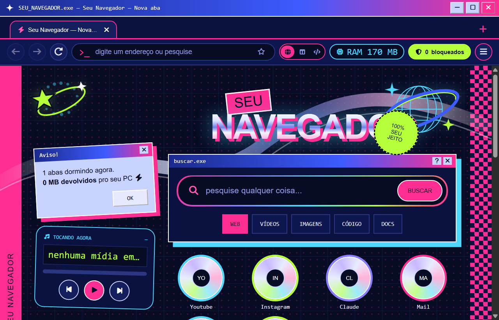

</div>

---

## Why Seu Navegador?

1. **Measurably lower RAM on real multi-tab workloads.** Automatic tab lifecycle (`Active -> Background -> Sleeping`) unloads idle Chromium renderers, saves compressed JPEG thumbnails to disk (`0 B` in RAM), preserves Back/Forward stacks and scroll positions, and protects tabs with audio, dirty forms/`contenteditable`, `beforeunload`, downloads, or allowlisted domains.
2. **100% customizable interface — not just accent colors.** Ships with **9 completely distinct official interfaces** built purely on the public declarative theme API (custom titlebars, tab bars, typography, layouts, and per-site skins), plus a built-in **Visual Theme Editor** with live **WCAG AA** contrast checks, offline font import, live folder hot-reload, and `.seutheme` ZIP sharing.
3. **Browser + Lightweight Studio IDE in one toggle (`seu://studio/`).** Switch in one click between **Browser-only** (`0 MB` IDE overhead), **Split View** (Studio paired live with any real browser tab), or **Studio-only** — featuring a theme-aware CodeMirror 6 editor, Git status/diff, integrated terminal, and a hybrid **Multi-Agent Orchestrator** (direct APIs + local CLIs) with live **Browser QA** inspection.
4. **Zero Microsoft runtime bloat for end users.** No WebView2, no Edge dependency, no `.NET` runtime, and no MSIX installer required.

---

## Measured RAM Benchmark (15 Real Tabs)

Measured on Windows 11 x64 (`AMD Ryzen 5`, `15.3 GB RAM`) across the **entire OS process tree** (browser + GPU + network/utility + all renderers) loading the exact same 15 URLs from [`bench/urls.json`](./bench/urls.json). Chrome ran in a fresh isolated `--user-data-dir` profile.

| Browser | 1-Tab Baseline (Private) | 15 Tabs Live (Private) | Post-Sleep / Steady (Private) | OS Processes (End) |
|---|---:|---:|---:|---:|
| **Seu Navegador** | **179.8 MB** *(529.9 WS)* | **1240.3 MB** *(2649.0 WS)* | **704.4 MB** *(1347.3 WS)* | **13** |
| **Google Chrome** | **468.2 MB** *(832.6 WS)* | **1489.6 MB** *(2597.3 WS)* | **1466.7 MB** *(2540.9 WS)* | **34** |

- **61.6% less RAM** at 1-tab baseline (`179.8 MB` vs `468.2 MB`).
- **16.7% less RAM** with all 15 tabs live simultaneously (`1240.3 MB` vs `1489.6 MB`).
- **52.0% less RAM** (`762.3 MB` returned to Windows) once idle tabs sleep (`704.4 MB` vs `1466.7 MB`, while keeping the active tab and protected tabs awake).

Reproduce it yourself on your own machine:
```powershell
node bench/ram-benchmark.mjs --mode quick   # ~90s verification (Seu Navegador vs Chrome/Firefox)
node bench/ram-benchmark.mjs --mode full    # Full 0 / 5 / 15 minute SPEC §12 run
```
Full methodology and raw JSON output live in [`bench/README.md`](./bench/README.md) and [`bench/results/latest.md`](./bench/results/latest.md).

---

## All 9 Official Themes (Hot-Swappable, Zero Restart)

Every official theme uses only the public declarative theme API (`manifest.json` + semantic `tokens.json` + HTML/CSS + bundled offline OFL fonts) and automatically themes internal `seu://` pages, Incognito windows, DevTools (`F12`), and Seu Studio.

| Y2K Maximal *(Default)* | Glassmorphism | Neumorphism |
| :---: | :---: | :---: |
|  | 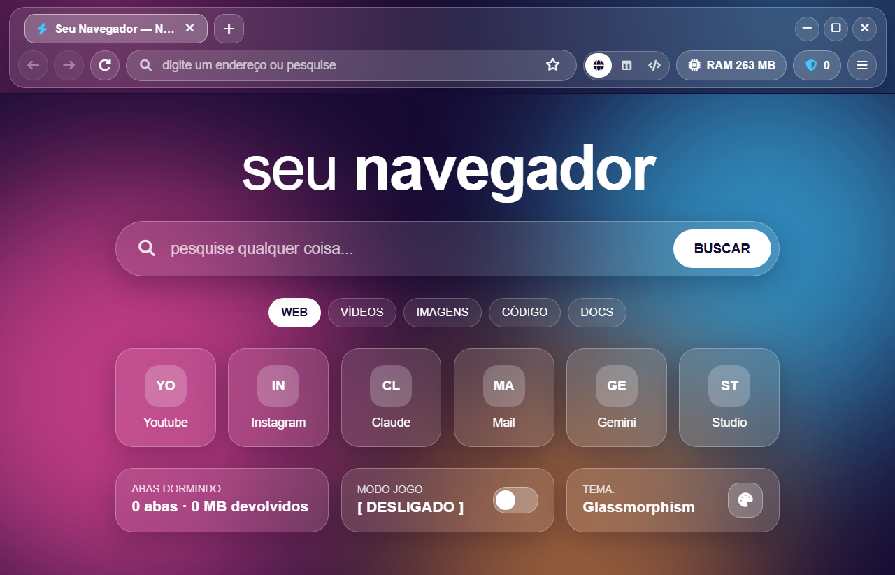 | 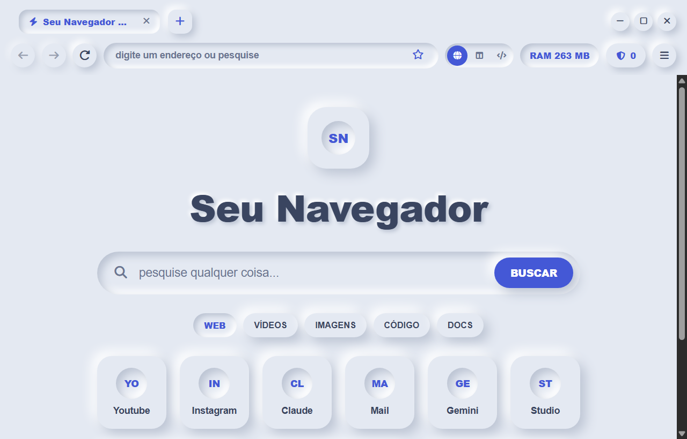 |

| Editorial | Brutalist | Neobrutalist |
| :---: | :---: | :---: |
| 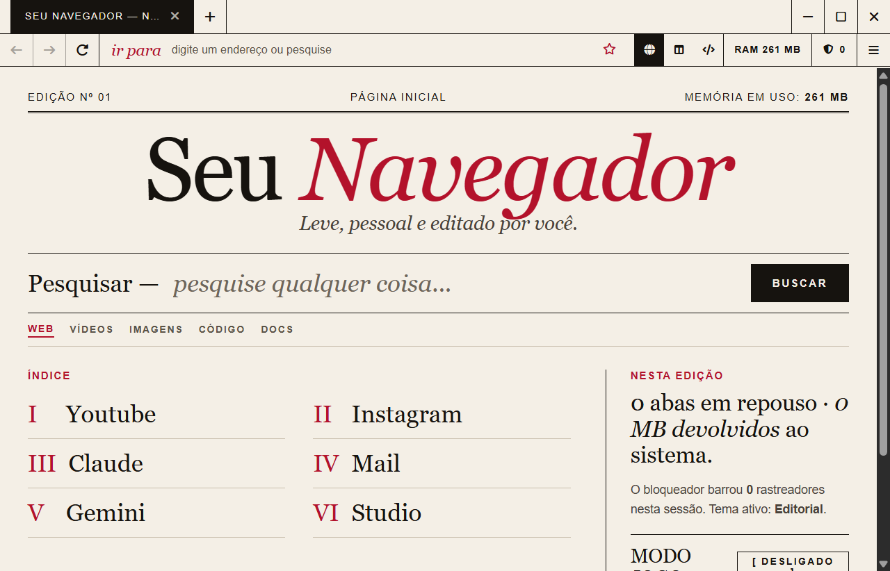 | 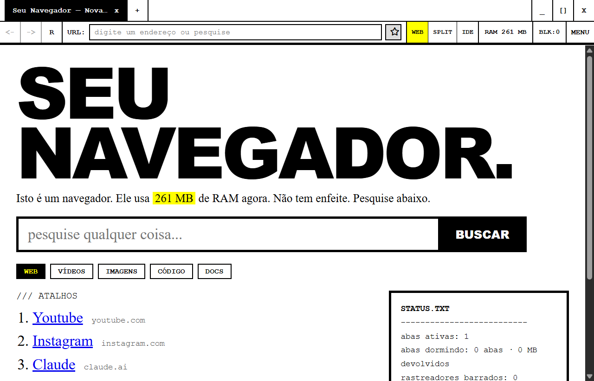 | 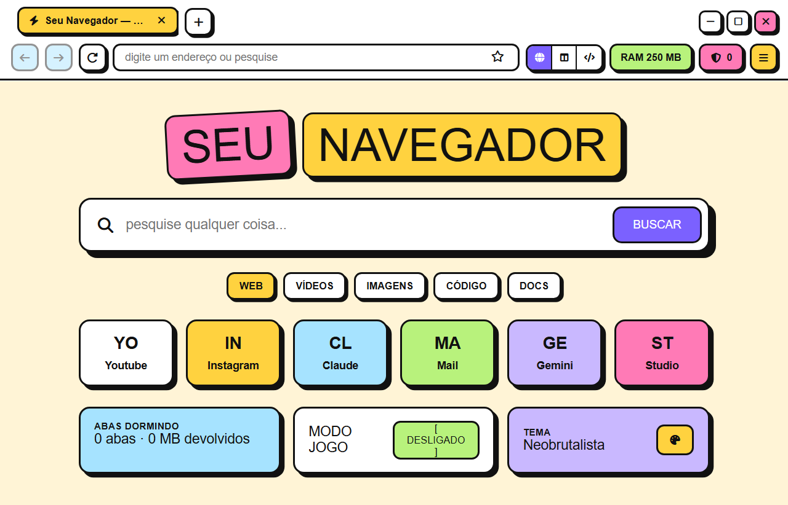 |

| Retro 70s | Y2K Classic | Maximal |
| :---: | :---: | :---: |
| 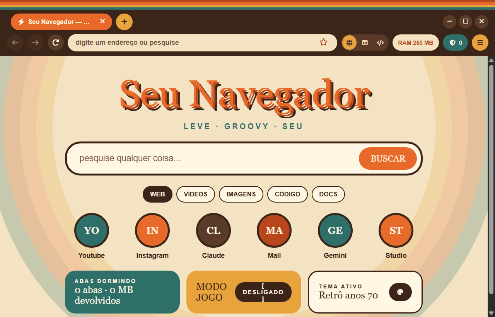 | 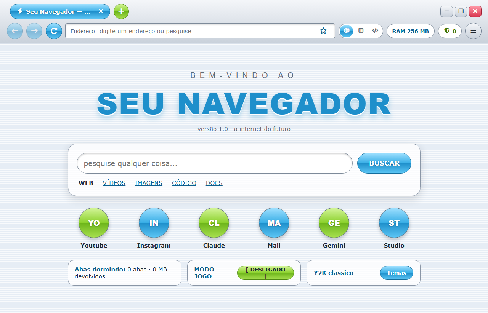 | 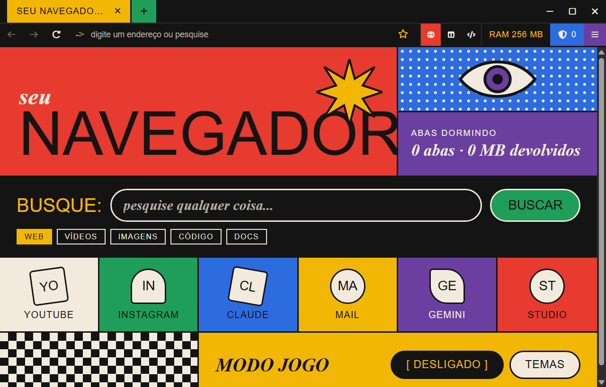 |

---

## Feature Highlights

### Theme Gallery & Visual Theme Editor (`seu://themes/` · `seu://themes/editor`)
- Copy-on-write theme creation from any of the 9 official themes, live **WCAG 2.1 AA / AAA** contrast checker across 5 semantic pairs, side-by-side live preview (Shell + New Tab + Studio + Incognito), offline `.woff2`/`.ttf` font upload, folder hot-reload, and safe `.seutheme` ZIP import/export.

| Theme Gallery (`seu://themes/`) | Visual Theme Editor (`seu://themes/editor`) |
| :---: | :---: |
| 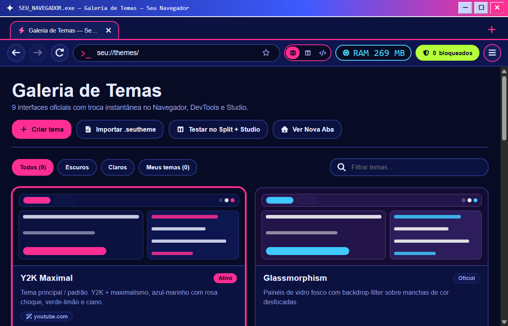 | 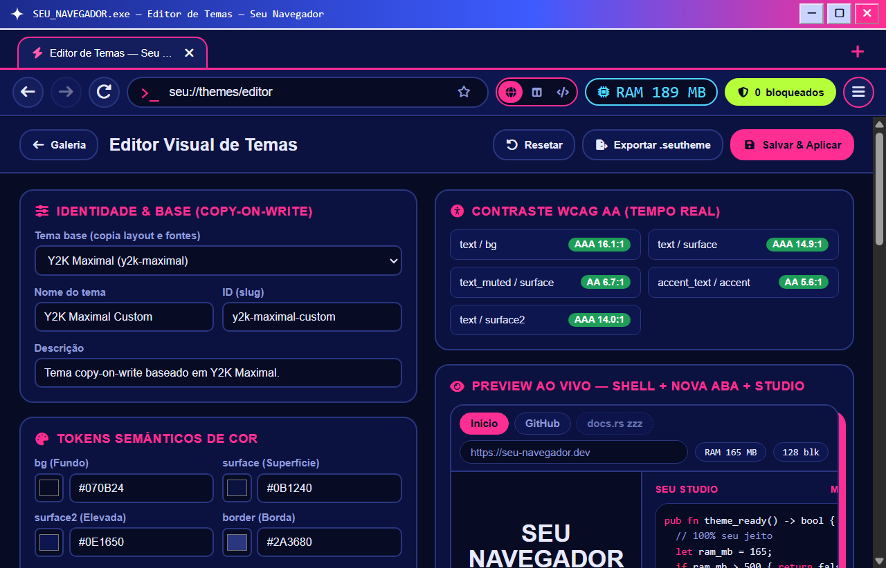 |

### Integrated Studio IDE & Multi-Agent Orchestrator (`seu://studio/`)
- Toggleable **Browser / Split View / Studio** layout (`Ctrl+Shift+E`).
- CodeMirror 6 editor styled 100% with active `--seu-*` theme tokens, file tree, workspace search, Git branch/diff viewer, integrated terminal, and a multi-agent board supporting both **Direct APIs** (Gemini, Anthropic, OpenAI, Ollama) and **Local CLIs** (`gemini-cli`, `claude-code`, `codex-cli`) with live **Browser QA** tools wired directly to the paired browser tab.

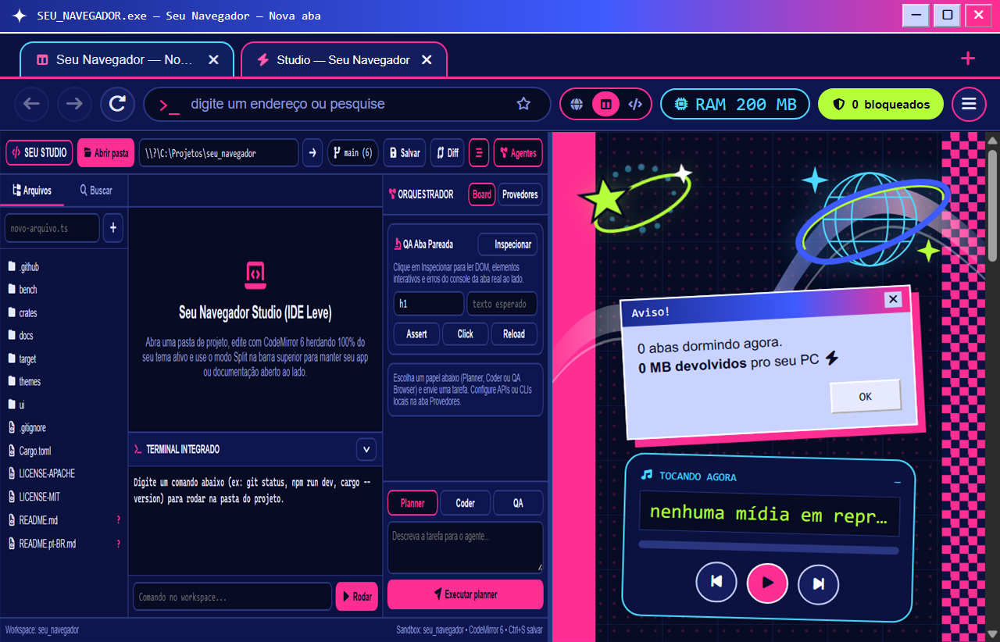

### Built-in Ad & Tracker Blocker, Per-Site Skins, Game Mode & Now Playing
- **Ad & Tracker Blocker:** Brave's `adblock` Rust engine with embedded EasyList + EasyPrivacy + uBlock Filters, cosmetic hiding, YouTube scriptlets (`##+js`), background daily list updates, live counters, and per-site allowlist.
- **Per-Site Skins (CSS + Isolated JS):** Anti-flash CSS injection at `on_load_start`, isolated JS with SPA navigation tracking, flagship **YouTube Y2K Maximal skin** (hides Shorts + Wide Player toggle), global kill-switch in `seu://settings/`, and mandatory explicit opt-in for JS inside imported `.seutheme` packages.
- **Game Mode (Win32):** Auto-detects exclusive Direct3D fullscreen (`SHQueryUserNotificationState`), Borderless Fullscreen (explicitly excluding `seu-navegador.exe` so fullscreen YouTube never triggers it), configurable `.exe` game lists with debounce, and minimized browser timeout. Sleeps all eligible tabs on enter and reports MB returned on exit without auto-waking tabs.
- **Now Playing Controls:** Synchronous `document_start` `navigator.mediaSession` shim (intercepting `setActionHandler` & `metadata`) + `<video>`/`<audio>` fallback surfaced in the New Tab widget, Shell indicator pill, and Overlay media popover.
- **Full Everyday Browser:** Multi-window frameless Win32 chrome, Tab Groups (color/collapse/drag), tear-off & cross-window tab movement, History, Bookmarks (`Ctrl+D`, folders, Netscape HTML import), Downloads manager, Session Restore (inactive tabs start sleeping), Incognito mode, Site Permissions, and docked themed DevTools (`F12`).

---

## Architecture

```text
seu-navegador/
├── crates/
│   ├── core/       # Tabs, groups, memory policies, Game Mode, Now Playing (0 CEF/Win32 deps)
│   ├── storage/    # SQLite (bundled rusqlite): history, bookmarks, downloads, session, settings
│   ├── themes/     # Manifest/token validation, HTML/CSS sanitizer, WCAG AA, .seutheme ZIP, site skins
│   ├── blocker/    # Brave adblock-rust engine + cosmetic rules + scriptlets + list updater
│   ├── bridge/     # Typed JSON window.seu RPC dispatcher (strictly gated to seu:// origins)
│   ├── studio/     # Workspace sandbox, file/Git/terminal services & multi-agent orchestrator
│   ├── engine/     # BrowserBackend trait + CEF 156 Alloy backend, Win32 metrics & game detector
│   └── app/        # Entry point, CEF multiprocess bootstrap & frameless Win32 multi-window host
├── ui/             # TypeScript + Vite privileged UI (Shell, Overlay, NewTab, Settings, Themes, Studio)
├── themes/         # The 9 official declarative theme packages + bundled OFL fonts
├── bench/          # Reproducible 15-tab RAM benchmark suite
└── docs/           # SPEC, ADRs, theme guide, QA test plan & screenshots
```

### Security Model
- **Strict origin isolation:** `window.cefQuery` / `window.seu` bridge is injected **exclusively** into `seu://` origins inside `RenderProcessHandler::on_context_created`. External websites never receive access to the bridge.
- **Defense-in-depth theme sanitization:** Strict CSP on `seu://` (`default-src 'self'`, no external network, no inline scripts, no `eval`) combined with Rust-side HTML/CSS sanitization blocking `<script>`, `<iframe>`, `on*=`, `javascript:`, `@import`, and external `url(http...)`.
- **Site script opt-in:** Imported `.seutheme` ZIP archives always force `permissions.site_scripts = false` until the user explicitly opts in after a clear warning; site scripts run in an isolated wrapper with `seu = undefined`.
- **Android-ready portable core:** `core`, `storage`, `themes`, `blocker`, `bridge`, and `studio` carry zero CEF or Win32 dependencies (verified on Linux CI alongside Windows x64), ready for future UniFFI / GeckoView reuse ([SPEC §12.1](./docs/SPEC.md)).

---

## Building & Running

See [ADR 001](./docs/adr/001-toolchain-and-cef-runtime.md) and [ADR 002](./docs/adr/002-chromium-memory-flags.md) for toolchain and Chromium memory flag details.

### Download for Windows x64 (Zero Microsoft Runtimes Required)
Download the latest release directly from [**GitHub Releases**](https://github.com/yanmamede10/seu-navegador/releases):
- **Installer (`seu-navegador-<ver>-win64-setup.exe`):** Built with Inno Setup 6 (no MSIX). Installs per-user without admin UAC prompt, creates Start Menu/Desktop shortcuts, and registers `.seutheme` file icons.
- **Portable ZIP (`seu-navegador-<ver>-win64-portable.zip`):** Extract anywhere and run `seu-navegador.exe`.
- **Verified self-contained:** Compiled with `-C target-feature=+crt-static` and verified on every CI/Release build by [`packaging/audit-pe-deps.mjs`](./packaging/audit-pe-deps.mjs) to confirm zero `VCRUNTIME` / `MSVCP` / WebView2 / `.NET` runtime dependencies.

> **Publishing a new release (maintainers):** Push a tag (`git tag v0.1.0-beta.1 && git push origin v0.1.0-beta.1`) or trigger `.github/workflows/release.yml` via GitHub Actions to build, audit, checksum (`SHA256SUMS.txt`), and publish both the portable ZIP and Setup installer automatically.

### Local Development
```bash
# 1. Build the TypeScript/Vite UI bundle
cd ui && npm install && npm run build

# 2. Check & test all platform-agnostic Rust crates (works on Windows, Linux, or macOS)
cargo test -p seu-core -p seu-storage -p seu-themes -p seu-blocker -p seu-bridge -p seu-studio

# 3. Full Windows x64 build (requires CEF_PATH + MSVC toolchain, automated in GitHub Actions)
cargo build --release -p seu-navegador
```

---

## Honest Limitations (v1)

Transparency matters:
- **No DRM (Widevine):** Netflix, Spotify Web, and other EME/Widevine DRM services are intentionally out of scope for v1.
- **No proprietary H.264/AAC codecs:** Uses standard open-source CEF codecs (YouTube works smoothly via VP9/AV1/Opus).
- **Windows x64 only for v1:** Linux/macOS desktop and Android (Kotlin + GeckoView via UniFFI) are planned future targets.
- **No cloud sync or Chrome Web Store extensions:** Focused on local speed, built-in adblocking, and native theme/site-skin extensibility.
- **Shared Chromium renderers:** When two tabs share a renderer process, sleeping only one of them may not immediately return OS memory until all tabs in that renderer sleep; Seu Navegador detects and reports this honestly in the Memory Popover rather than faking savings.
- **CEF Sandbox (`no_sandbox` in v1):** As documented in [ADR 001](./docs/adr/001-toolchain-and-cef-runtime.md), v1 runs with `no_sandbox = 1` due to `cef-rs` 156 Windows `cef_sandbox.lib` integration constraints; multi-process separation, strict `seu://`-only bridge gating, CSP, Rust HTML/CSS sanitization, and imported site-JS opt-in remain enforced.

---

## License

Dual-licensed under either of:
- [MIT License](./LICENSE-MIT)
- [Apache License, Version 2.0](./LICENSE-APACHE)

at your option. Bundled fonts in `themes/*/assets/fonts/` are licensed under the SIL Open Font License 1.1 (`OFL.txt`).
