<div align="center">

# Seu Navegador

**Um navegador leve, econômico em RAM e 100% personalizável para Windows feito em Rust + CEF, com Studio IDE e Orquestrador Multi-Agente integrados.**

[](./LICENSE-MIT)
[](#como-compilar-e-executar)
[](#arquitetura)

[**🇺🇸 Read in English**](./README.md) · [**Guia de Criação de Temas**](./docs/theme-guide.md) · [**Benchmark de RAM**](./bench/README.md) · [**Plano de Testes QA**](./docs/test-plan.md) · [**Especificação**](./docs/SPEC.md)

<br />

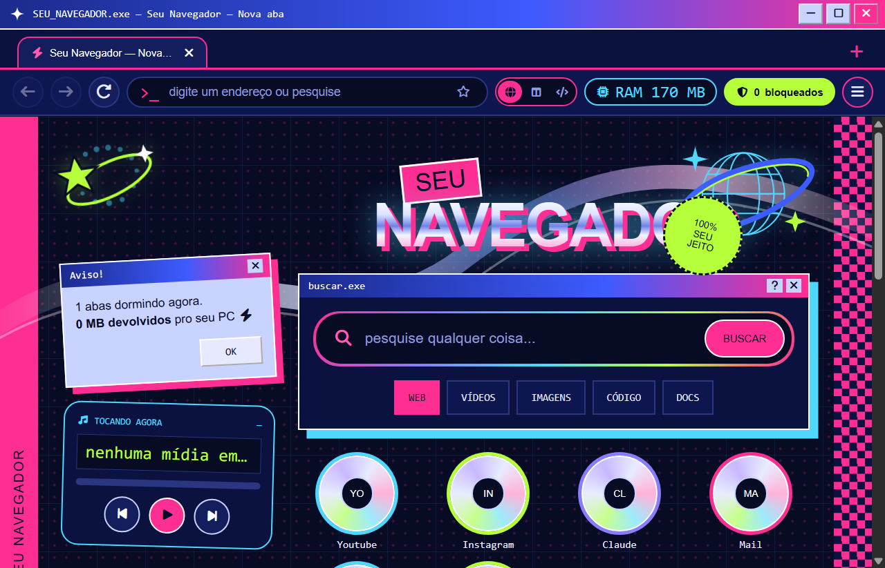

</div>

---

## Por que o Seu Navegador existe?

1. **Economia real e medida de RAM em uso multi-aba.** Ciclo de vida automático (`Ativa -> Segundo plano -> Dormindo`) fecha renderers ociosos do Chromium, grava miniaturas JPEG comprimidas em disco (`0 B` na RAM), preserva a pilha Voltar/Avançar e a rolagem, e protege abas com áudio, formulários/`contenteditable` alterados, `beforeunload`, downloads ou domínios configurados.
2. **100% personalizável — não apenas trocar a cor de destaque.** Vem com **9 interfaces oficiais completamente distintas** construídas apenas com a API pública declarativa de temas (titlebar própria, barra de abas, tipografia, layout e skins por site), além de **Editor Visual de Temas** com checagem **WCAG AA** ao vivo, importação de fontes offline, hot-reload de pasta e compartilhamento via `.seutheme`.
3. **Navegador + Studio IDE leve em 1 clique (`seu://studio/`).** Alterne instantaneamente entre **Só Navegador** (`0 MB` de overhead da IDE), **Split View** (Studio pareado lado a lado com qualquer aba real) ou **Só Studio** — com editor CodeMirror 6 100% temático (`--seu-*`), Git status/diff, terminal integrado e **Orquestrador Multi-Agente** híbrido (APIs diretas + CLIs locais) com ferramentas nativas de **QA no Navegador**.
4. **Zero runtimes da Microsoft para o usuário final.** Nada de WebView2, Edge, `.NET` runtime ou instalador MSIX.

---

## Benchmark Real de RAM (15 Abas)

Medido no Windows 11 x64 (`AMD Ryzen 5`, `15,3 GB RAM`) somando **toda a árvore de processos do SO** (browser + GPU + network/utility + todos os renderers) carregando exatamente as mesmas 15 URLs de [`bench/urls.json`](./bench/urls.json). O Chrome rodou em um perfil limpo e isolado (`--user-data-dir`).

| Navegador | Baseline 1 Aba (Private) | 15 Abas Vivas (Private) | Pós-Sleep / Estável (Private) | Processos (Fim) |
|---|---:|---:|---:|---:|
| **Seu Navegador** | **179,8 MB** *(529,9 WS)* | **1240,3 MB** *(2649,0 WS)* | **704,4 MB** *(1347,3 WS)* | **13** |
| **Google Chrome** | **468,2 MB** *(832,6 WS)* | **1489,6 MB** *(2597,3 WS)* | **1466,7 MB** *(2540,9 WS)* | **34** |

- **61,6% menos RAM** na baseline de 1 aba (`179,8 MB` vs `468,2 MB`).
- **16,7% menos RAM** com todas as 15 abas vivas simultaneamente (`1240,3 MB` vs `1489,6 MB`).
- **52,0% menos RAM** (**`762,3 MB` devolvidos ao Windows**) após o sleep das abas inativas (`704,4 MB` vs `1466,7 MB`, mantendo a aba ativa e abas protegidas acordadas).

Reproduza na sua própria máquina:
```powershell
node bench/ram-benchmark.mjs --mode quick   # Verificação rápida (~90s)
node bench/ram-benchmark.mjs --mode full    # Execução completa SPEC §12 (0, 5 e 15 min)
```
Metodologia detalhada e resultados brutos em [`bench/README.md`](./bench/README.md) e [`bench/results/latest.md`](./bench/results/latest.md).

---

## As 9 Interfaces Oficiais (Troca a Quente sem Reiniciar)

Todos os 9 temas usam exclusivamente a API pública declarativa (`manifest.json` + `tokens.json` semântico + HTML/CSS + fontes OFL embutidas) e estilizam automaticamente páginas `seu://`, janelas Anônimas, DevTools (`F12`) e o Seu Studio.

| Y2K Maximal *(Padrão)* | Glassmorphism | Neumorphism |
| :---: | :---: | :---: |
|  | 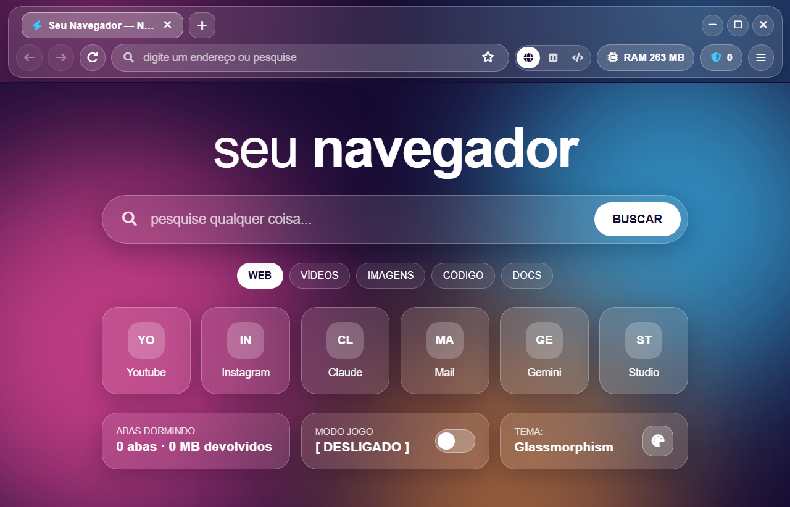 | 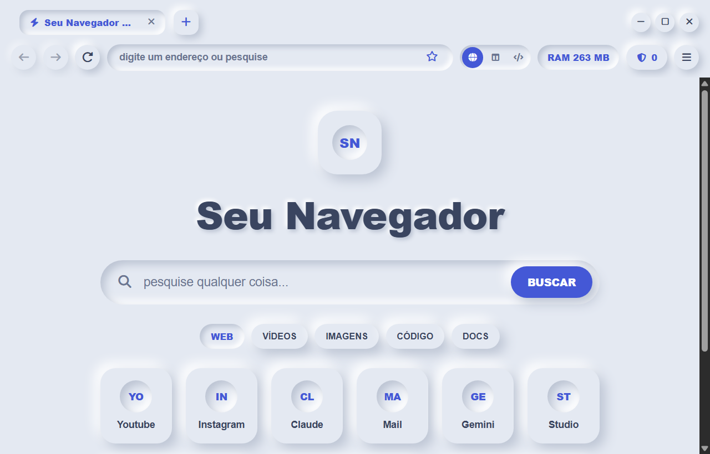 |

| Editorial | Brutalista | Neobrutalista |
| :---: | :---: | :---: |
| 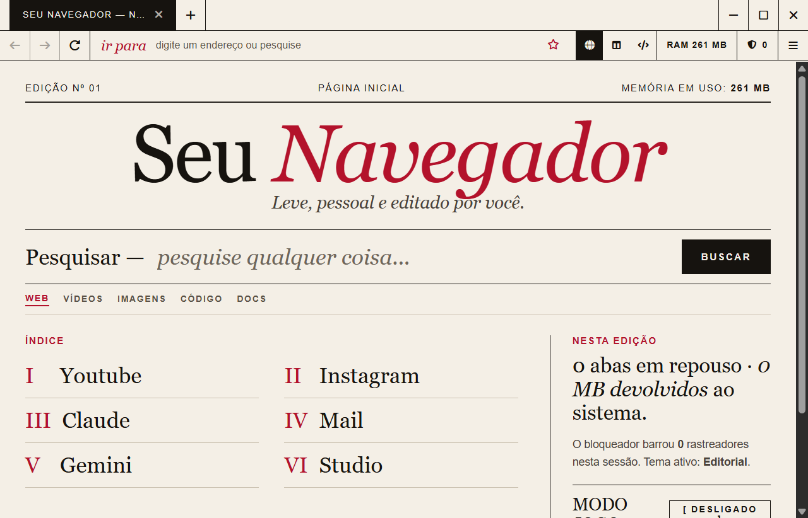 | 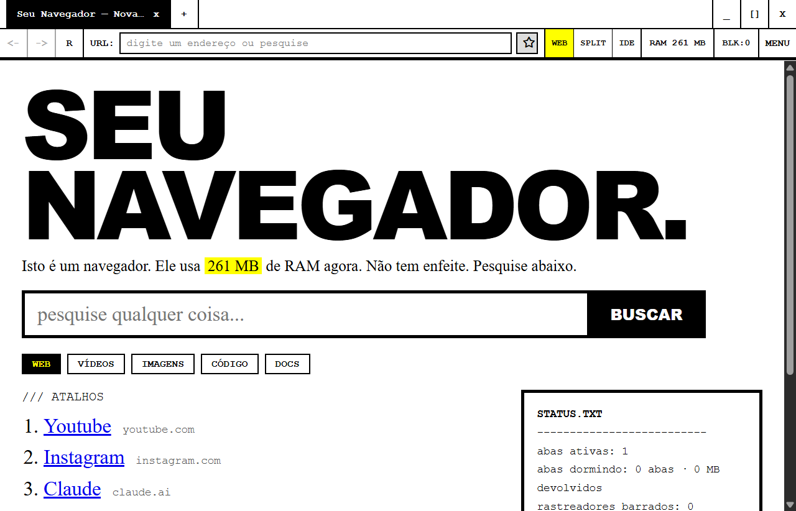 | 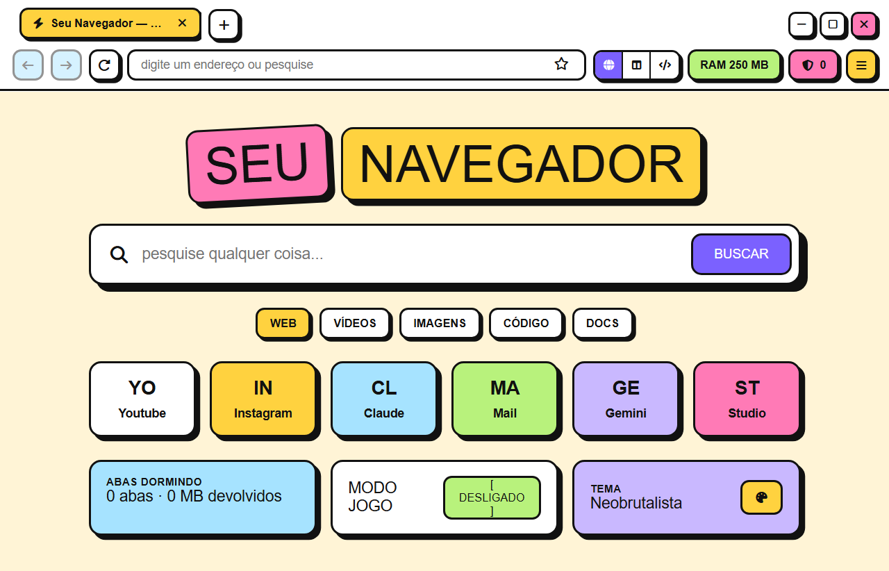 |

| Retrô Anos 70 | Y2K Clássico | Maximalista |
| :---: | :---: | :---: |
| 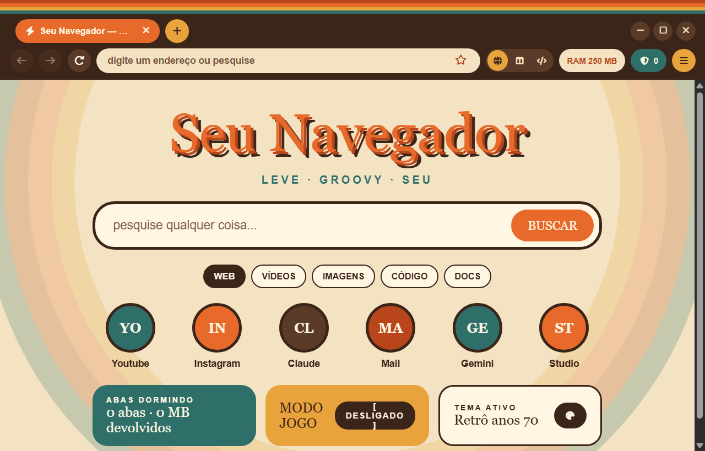 | 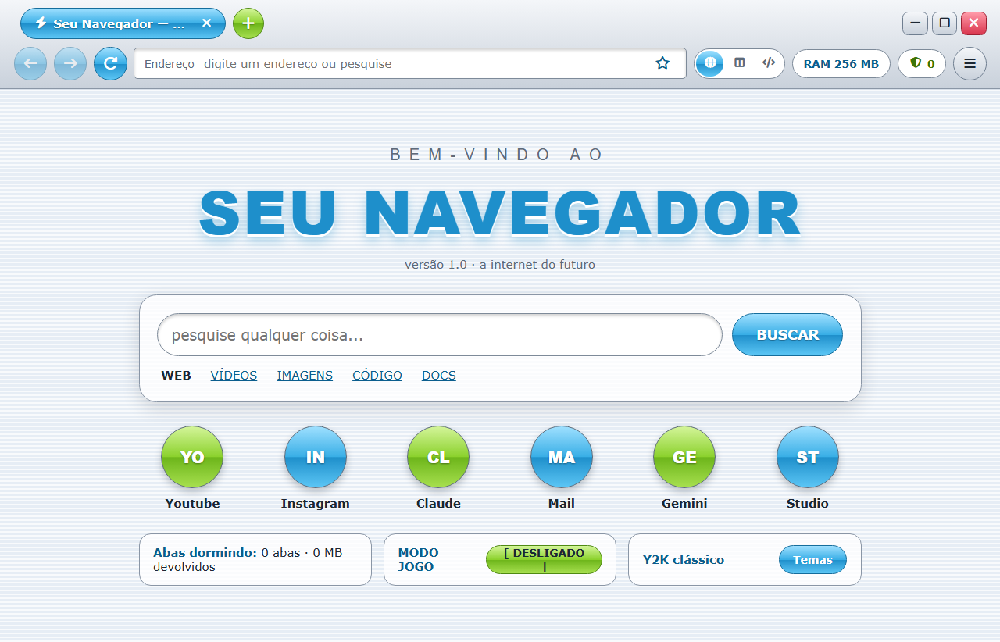 | 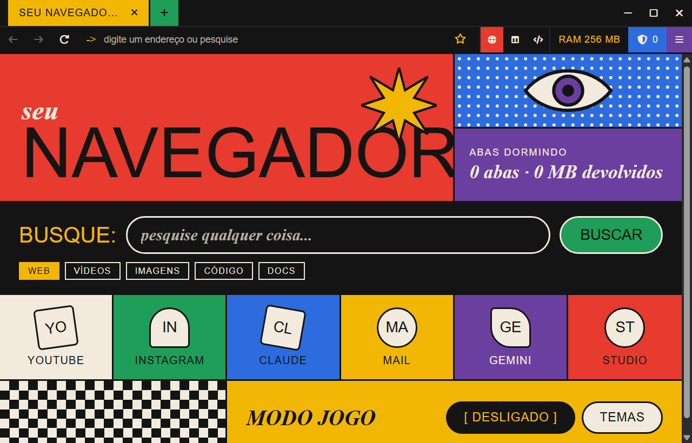 |

---

## Principais Recursos

### Galeria e Editor Visual de Temas (`seu://themes/` · `seu://themes/editor`)
- Criação *copy-on-write* a partir de qualquer tema oficial, verificação de contraste **WCAG 2.1 AA / AAA** em tempo real nos 5 pares semânticos, preview lado a lado (Shell + Nova Aba + Studio + Anônima), upload de fontes offline `.woff2`/`.ttf`, hot-reload automático da pasta de temas e importação/exportação segura de pacotes `.seutheme`.

| Galeria de Temas (`seu://themes/`) | Editor Visual (`seu://themes/editor`) |
| :---: | :---: |
| 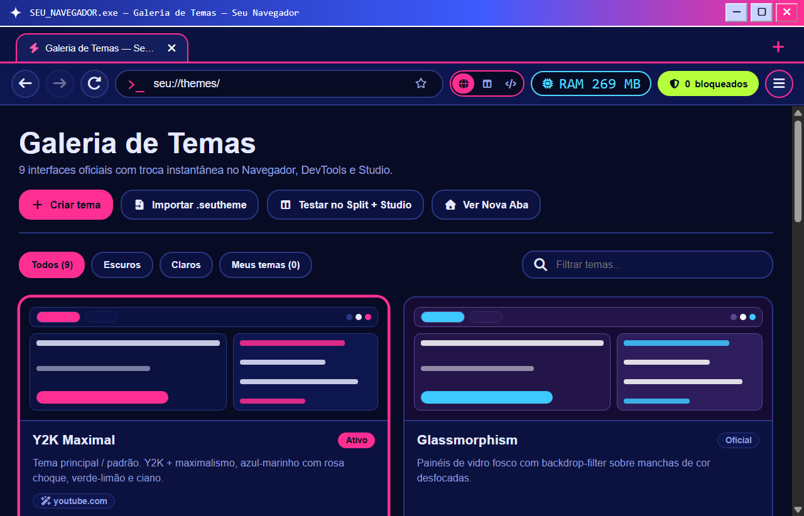 | 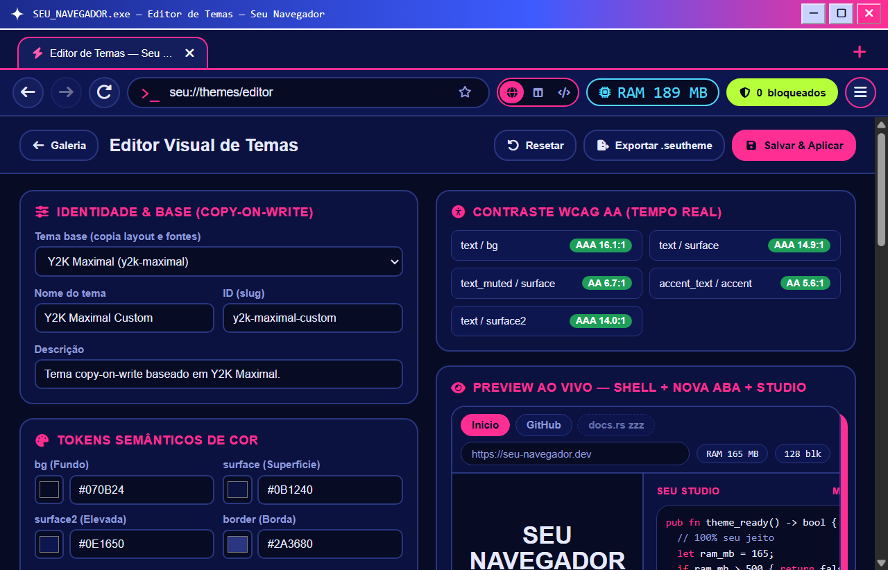 |

### Seu Studio IDE & Orquestrador Multi-Agente (`seu://studio/`)
- Alternância em 1 clique entre **Navegador / Split View / Studio** (`Ctrl+Shift+E`).
- Editor CodeMirror 6 herdando 100% os tokens `--seu-*` do tema ativo, árvore de arquivos, busca no workspace, Git status/diff, terminal integrado e board multi-agente híbrido (**APIs diretas**: Gemini, Claude, OpenAI, Ollama + **CLIs locais**: `gemini-cli`, `claude-code`, `codex-cli`) com inspeção **QA Browser** conectada direto na aba real pareada.

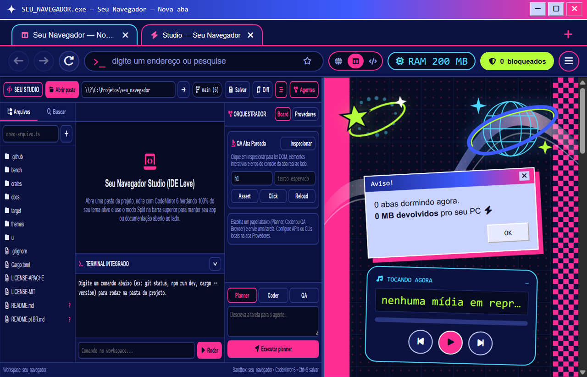

### Bloqueador Nativo, Skins por Site, Modo Jogo & Tocando Agora
- **Bloqueador de Anúncios e Rastreadores:** Motor `adblock` (Brave) em Rust com EasyList + EasyPrivacy + uBlock Filters, regras cosméticas, scriptlets (`##+js`) para YouTube, atualização diária em segundo plano, contadores ao vivo e allowlist por site.
- **Skins por Site (CSS + JS isolado):** Injeção anti-flash no `on_load_start`, JS isolado com suporte a navegação SPA, **skin vitrine do YouTube no `y2k-maximal`** (esconde Shorts + modo Player Amplo), interruptor global em `seu://settings/` e opt-in explícito obrigatório para JS de temas `.seutheme` importados.
- **Modo Jogo (Win32):** Detecção automática de Direct3D fullscreen exclusivo (`SHQueryUserNotificationState`), Borderless Fullscreen (excluindo explicitamente o próprio `seu-navegador.exe` para YouTube em tela cheia nunca disparar), lista configurável de `.exe` com debounce e tempo minimizado. Ao entrar dorme todas as abas elegíveis; ao sair não acorda sozinho e informa quantos MB foram devolvidos.
- **Tocando Agora:** Shim síncrono em `document_start` para `navigator.mediaSession` + fallback em `<video>`/`<audio>` integrado ao widget da Nova Aba, pílula na Shell e popover de mídia.
- **Navegador Completo:** Múltiplas janelas Win32 frameless, Grupos de Abas, arrastar abas entre janelas (*tear-off*), Histórico, Favoritos (`Ctrl+D`, pastas, importação Netscape HTML), Downloads, Restaurar Sessão (abas inativas iniciam dormindo), Modo Anônimo, Permissões de site e DevTools acoplado temático (`F12`).

---

## Arquitetura

```text
seu-navegador/
├── crates/
│   ├── core/       # Abas, grupos, memória, Modo Jogo, Tocando Agora (0 deps CEF/Win32)
│   ├── storage/    # SQLite (rusqlite bundled): histórico, favoritos, downloads, sessão, configs
│   ├── themes/     # Validação manifest/tokens, sanitizador HTML/CSS, WCAG AA, .seutheme, skins
│   ├── blocker/    # Motor Brave adblock + cosméticos + scriptlets + atualizador de listas
│   ├── bridge/     # Ponte tipada JSON window.seu (restrita estritamente a origens seu://)
│   ├── studio/     # Sandbox do workspace, Git, terminal e orquestrador multi-agente
│   ├── engine/     # Trait BrowserBackend + backend CEF 156 Alloy, métricas Win32 e detector de jogos
│   └── app/        # Main, bootstrap multiprocesso CEF e host multi-janela Win32 frameless
├── ui/             # UI privilegiada TypeScript + Vite (Shell, Overlay, NewTab, Settings, Themes, Studio)
├── themes/         # Os 9 pacotes de temas oficiais + fontes OFL embutidas
├── bench/          # Suite reproduzível de benchmark de RAM (15 abas)
└── docs/           # SPEC, ADRs, guia de temas, plano de testes QA e screenshots
```

### Modelo de Segurança
- **Isolamento estrito de origem:** A ponte `window.cefQuery` / `window.seu` é injetada **exclusivamente** em origens `seu://` dentro de `RenderProcessHandler::on_context_created`. Sites externos nunca têm acesso à ponte.
- **Sanitização em profundidade:** CSP rígida em `seu://` somada à sanitização em Rust que bloqueia `<script>`, `<iframe>`, atributos `on*=`, `javascript:`, `@import` e `url(http...)` externos nos temas.
- **Opt-in de scripts de site:** Todo pacote `.seutheme` importado força `permissions.site_scripts = false` até autorização explícita do usuário após aviso claro; scripts rodam em wrapper isolado com `seu = undefined`.
- **Núcleo portátil pronto para Android:** `core`, `storage`, `themes`, `blocker`, `bridge` e `studio` não têm nenhuma dependência de CEF ou Win32 (testados também no CI Linux), prontos para reuso futuro com Kotlin + GeckoView via UniFFI ([SPEC §12.1](./docs/SPEC.md)).

---

## Como Compilar e Executar

Consulte o [ADR 001](./docs/adr/001-toolchain-and-cef-runtime.md) e o [ADR 002](./docs/adr/002-chromium-memory-flags.md) para detalhes da toolchain e flags de memória do Chromium.

### Baixar Artefato Portátil (Windows x64)
Cada push na `main` gera automaticamente um `.zip` portátil para Windows x64 via GitHub Actions (`.github/workflows/ci.yml`). Basta extrair e abrir `seu-navegador.exe` — sem instaladores ou runtimes da Microsoft.

### Desenvolvimento Local
```bash
# 1. Compilar o bundle de UI (TypeScript + Vite)
cd ui && npm install && npm run build

# 2. Rodar testes dos crates portáteis em Rust (Windows, Linux ou macOS)
cargo test -p seu-core -p seu-storage -p seu-themes -p seu-blocker -p seu-bridge -p seu-studio

# 3. Build completo Windows x64 (requer CEF_PATH + MSVC, automatizado no GitHub Actions)
cargo build --release -p seu-navegador
```

---

## Limitações Honestas (v1)

- **Sem DRM (Widevine):** Netflix, Spotify Web e outros serviços com DRM Widevine estão fora do escopo da v1.
- **Sem codecs proprietários H.264/AAC:** Usa os codecs open-source padrão do CEF (YouTube funciona normalmente via VP9/AV1/Opus).
- **Windows x64 na v1:** Desktop Linux/macOS e Android (Kotlin + GeckoView via UniFFI) ficam para versões futuras.
- **Sem sincronização em nuvem ou extensões da Chrome Web Store:** Foco em leveza local, bloqueador embutido e extensibilidade por temas/skins.
- **Renderers compartilhados do Chromium:** Quando duas abas dividem o mesmo processo renderer, dormir apenas uma delas pode não devolver RAM imediatamente ao SO até todas do processo dormirem; o Seu Navegador detecta e informa isso honestamente no popover de Memória.

---

## Licença

Licença dupla à sua escolha:
- [MIT License](./LICENSE-MIT)
- [Apache License, Version 2.0](./LICENSE-APACHE)

As fontes embutidas em `themes/*/assets/fonts/` seguem a licença SIL Open Font License 1.1 (`OFL.txt`).
